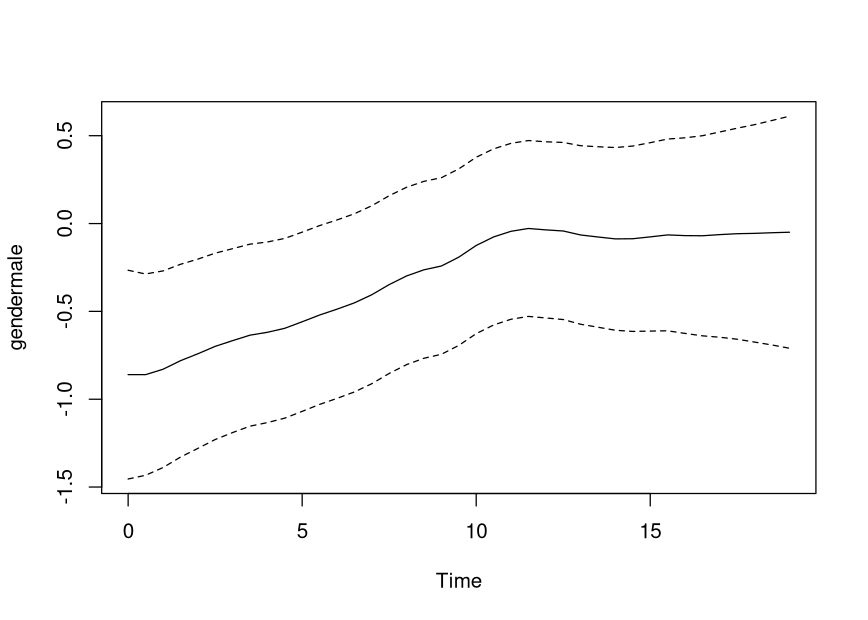
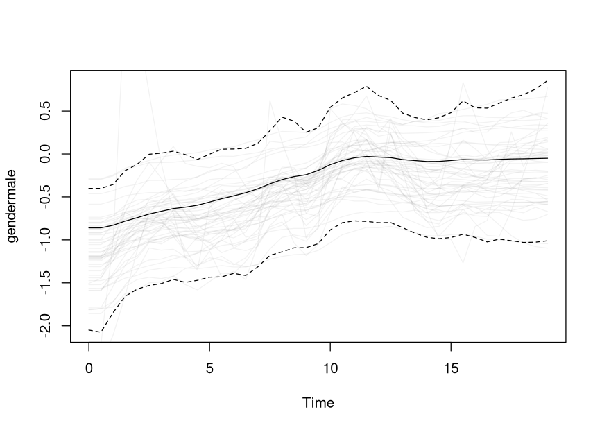
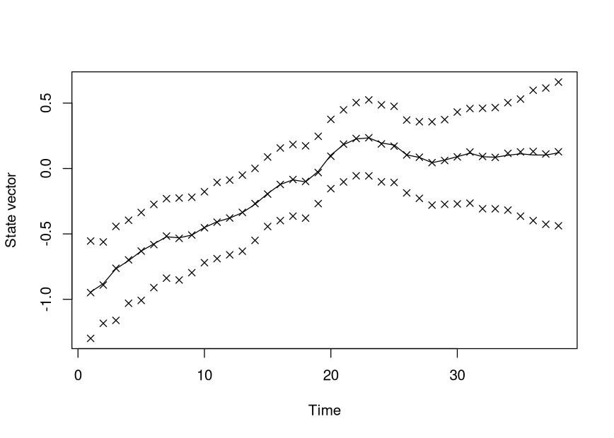
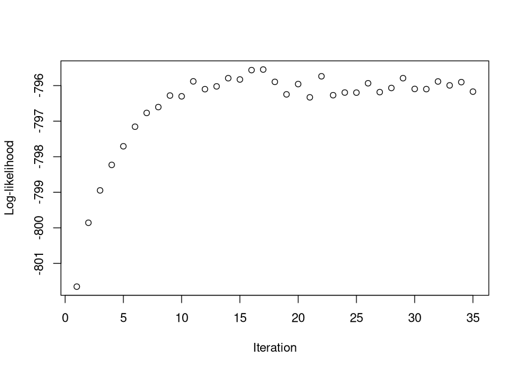

# dynamichazard

[](https://github.com/boennecd/dynamichazard/actions/workflows/R-CMD-check.yaml) [](https://CRAN.R-project.org/package=dynamichazard) [](https://cranlogs.r-pkg.org/)

The `dynamichazard` package estimates time-varying effects in survival analysis. Its state space models use random walks for the coefficients and can extrapolate beyond the last observation period. The particle filter and smoother can fit more general state space models. See the [examples](examples/) directory for additional models.

## Installation

Install `dynamichazard` from GitHub.

``` r
# install.packages(pkgs = "remotes")
remotes::install_github(repo = "boennecd/dynamichazard")
```

When a version is available on CRAN, you can install it with `install.packages(pkgs = "dynamichazard")`.

After installation, use `browseVignettes(package = "dynamichazard")` to open the package vignettes.

## Example - ddhazard

Install `JM` to run the examples. The `aids` data set from `JM` records a randomized trial of two drugs for patients with HIV. The data record time to death or right censoring. This example keeps one row per patient and omits the longitudinal `CD4` measurements.

- `AZT` indicates whether the patient entered the trial because of intolerance to zidovudine or because zidovudine had failed.
- `prevOI` indicates whether the patient entered the trial with an AIDS diagnosis or two CD4 counts of 300 or fewer.
- `drug` gives the assigned drug, `ddC` or `ddI`.
- `gender` gives the recorded gender.

``` r
library(package = dynamichazard)
#> Loading required package: survival
aids <- JM::aids

# Keep the final row for each patient and remove unused columns.
aids <- aids[aids$Time == aids$stop, ]
aids <- aids[, !colnames(x = aids) %in% c("Time", "death", "obstime", "CD4")]

# Inspect the first rows and the latest follow-up and event times.
head(x = aids)
#>    patient drug gender prevOI         AZT start  stop event
#> 3        1  ddC   male   AIDS intolerance    12 16.97     0
#> 7        2  ddI   male noAIDS intolerance    18 19.00     0
#> 10       3  ddI female   AIDS intolerance     6 18.53     1
#> 14       4  ddC   male   AIDS     failure    12 12.70     0
#> 18       5  ddI   male   AIDS     failure    12 15.13     0
#> 19       6  ddC female   AIDS     failure     0  1.90     1
max(aids$stop)                  # Last observation time
#> [1] 21.4
max(aids$stop[aids$event == 1]) # Last person with event
#> [1] 19.07

# Fit model with extended Kalman filter
fit <- ddhazard(
  formula = Surv(time = stop, event = event) ~ ddFixed_intercept() + ddFixed(AZT) + gender +
    ddFixed(drug) + ddFixed(prevOI),
  data = aids,
  model = "exponential",          # piecewise constant exponentially distributed 
                                  # arrivals times
  by = .5,                        # Length of time intervals in state space 
                                  # model
  max_T = 19,                     # Last period we observe when modeling
  Q = .1^2,                       # Covariance matrix for state equation in 
                                  # first iteration
  Q_0 = 1,                        # Covariance matrix for the prior
  control = ddhazard_control(
    eps = .001,                   # tolerance for EM-algorithm
    LR = .9,                      # Learning rate
    n_max = 100                   # Max number iterations in EM
    ))
#> a_0 not supplied. IWLS estimates of static glm model is used for random walk models. Otherwise the values are zero

# Plot the estimates. Dashed lines are 95% confidence bounds
plot(x = fit)
```

<!-- -->

``` r

# Bootstrap the estimates
set.seed(seed = 87754771)
boot_out <- ddhazard_boot(ddhazard_fit = fit, R = 1000) # R is number of bootstrap samples

# Plot bootstrap estimates. Dashed lines are 2.5% and 97.5% quantiles of the 
# bootstrap estimates. Transparent lines are bootstrap estimates
plot(x = fit, ddhazard_boot = boot_out)
#> Only plotting 50 of the boot sample estimates
```

<!-- -->

Compare the dashed confidence bounds in the first plot with the bootstrap quantiles in the second plot. The bounds differ slightly in this example. Guo & Carlin (2004) analyze CD4 counts and fit an exponential survival model with time-invariant coefficients.

## Example - particle filter and smoother

This example fits a particle filter and smoother to the same data. Gender has a time-varying effect in both examples. This fit uses 200 particles for the forward and backward filters. The final call uses more particles to estimate the log-likelihood.

``` r
set.seed(seed = 20170907)
pf_fit <- PF_EM(
  formula = Surv(time = stop, event = event) ~ ddFixed_intercept() + ddFixed(AZT) + gender +
    ddFixed(drug) + ddFixed(prevOI),
  data = aids, model = "exponential",
  by = .5,  max_T = 19, Q = .5^2, Q_0 = 1,
  control = PF_control(
    n_threads = 2,
    N_fw_n_bw = 200, N_first = 200, N_smooth = 1,
    smoother = "Brier_O_N_square",
    eps = 0.001, n_max = 150L, est_a_0 = FALSE, nu = 6L,
    covar_fac = 1.2, averaging_start = 50L))
#> a_0 not supplied. IWLS estimates of static glm model is used for random walk models. Otherwise the values are zero
```

``` r
# Compare the state innovation variances.
pf_fit$Q
#>            gendermale
#> gendermale 0.02650917
fit$Q
#>            gendermale
#> gendermale 0.01648568
plot(x = pf_fit)
```

<!-- -->

``` r
plot(x = pf_fit$log_likes, xlab = "Iteration", ylab = "Log-likelihood")
```

<!-- -->

``` r
logLik(object = pf_fit)
#> 'log Lik.' -796.1694 (df=5)
```

``` r
# better estimate of final log-likelihood
logLik(object = PF_forward_filter(x = pf_fit, N_fw = 10000, N_first = 10000))
#> 'log Lik.' -795.9732 (df=NA)
```

The log-likelihood plot shows how the fit changes over the iterations. See the [particle filtering vignette](vignettes/Particle_filtering.pdf) for details.

# References

<div id="refs" class="references csl-bib-body hanging-indent" entry-spacing="0" line-spacing="2">

<div id="ref-guo2004" class="csl-entry">

Guo, X., & Carlin, B. P. (2004). Separate and joint modeling of longitudinal and event time data using standard computer packages. *The American Statistician*, *58*(1), 16–24.

</div>

</div>
